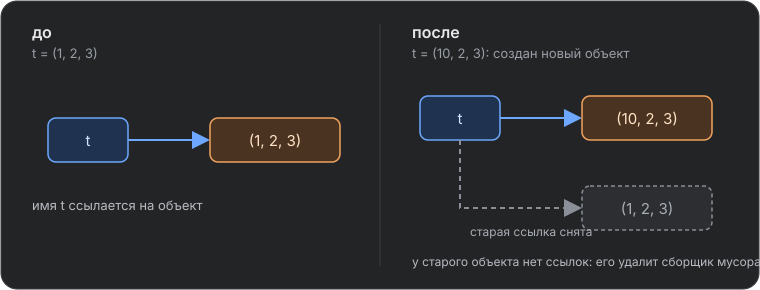
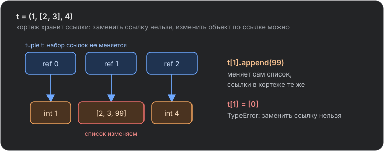
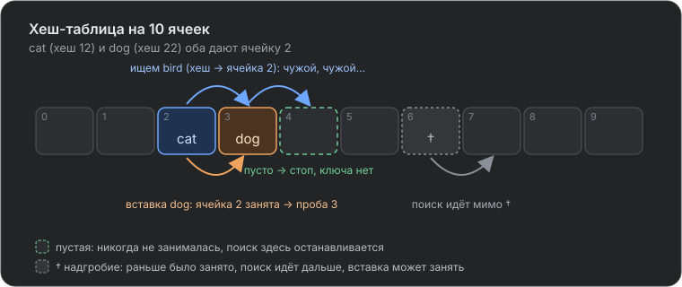
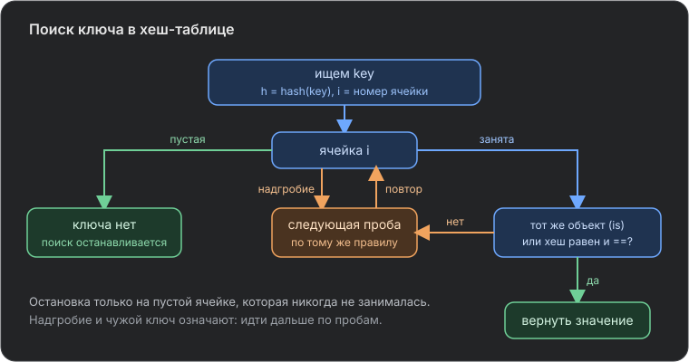
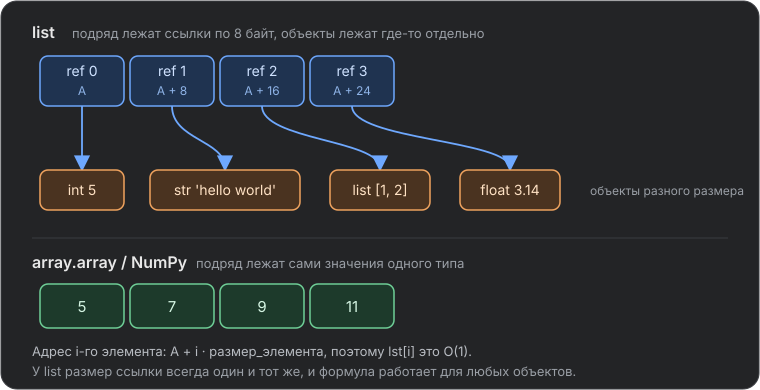
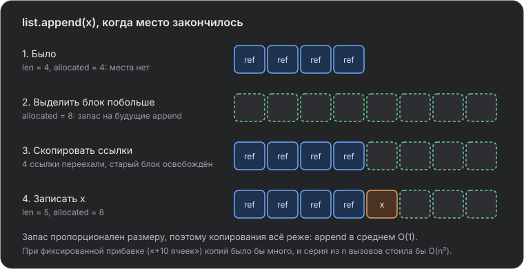
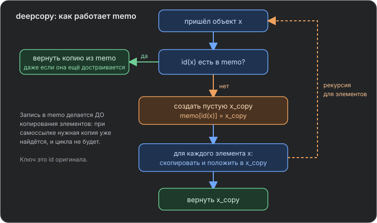
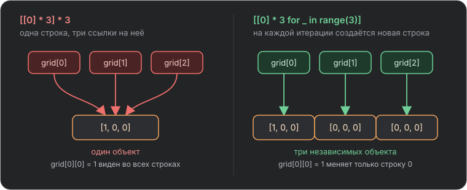
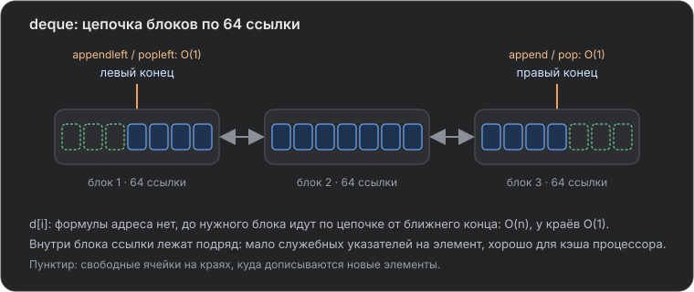

# Структуры данных и базовые типы

---
## Суть

Python-структуры данных (`list`, `tuple`, `dict`, `set`, `deque`, `str`, числа) отличаются устройством в памяти, а от устройства зависят стоимость операций и допустимые действия.

---
## Как это устроено

### 0. O-нотация: как считать стоимость

**O-нотация (Big O notation)** описывает, как растёт число операций при росте размера данных `n`.

- `O(1)`: число шагов не зависит от `n` (индексация `lst[i]`).
- `O(n)`: шаги растут пропорционально `n` (поиск `x in lst`).
- `O(n²)`: шаги растут пропорционально квадрату `n` (цикл из `n` вставок в начало списка).
- `O(log n)`: шаги растут очень медленно, например при бинарном поиске.

**Правила:**

1. Константные множители отбрасываются: `3n` и `n/2` это `O(n)`.
2. Остаётся слагаемое, которое растёт быстрее: `n² + 10n` это `O(n²)`.
3. Последовательные действия **складываются**, вложенные **перемножаются**: цикл из `n` шагов, на каждом поиск в списке из `k`, даёт `O(n·k)`. Создание `set` из `k` элементов и `n` проверок даёт `O(k + n)`.

| n | log₂ n | n | n·log₂ n | n² |
|---|--------|---|----------|----|
| 10 | 3 | 10 | 33 | 100 |
| 1 000 | 10 | 1 000 | 10 000 | 1 000 000 |
| 1 000 000 | 20 | 1 000 000 | 20 000 000 | 10¹² |

Три вида оценок:

- **Худший случай (worst case):** самый неудачный вход. Для `x in lst` это `O(n)`: элемента нет или он в конце.
- **Средний случай (average case):** типичный вход. Для `x in d` это `O(1)`.
- **Амортизированная сложность (amortized complexity):** средняя цена операции в длинной серии. Один `append` иногда дорог, но в среднем по серии он `O(1)`.

Оценка стоимости **одной** операции и всей серии из `n` операций это разные вещи. Нужно понимать разницу: `n` вызовов `O(1)` дают `O(n)` на серию, а не на вызов.

---
### 1. Имена, ссылки, изменяемость

Переменная в Python это **имя (name)**, которое **ссылается (reference)** на объект.
`t = (10, 2, 3)` создаёт новый объект и перепривязывает имя. Старый объект удаляется сборщиком мусора, когда на него не остаётся ссылок.
Функция `id(obj)` возвращает идентификатор объекта, а `a is b` проверяет, один ли это объект.
`a == b` сравнивает значения.



- **Изменяемые (mutable):** `list`, `dict`, `set`, `deque`. Объект можно менять на месте, `id` при этом не меняется (`lst[0] = 10`).
- **Неизменяемые (immutable):** `int`, `float`, `bool`, `str`, `tuple`. Любая «модификация» создаёт новый объект (`t + (4,)`). Попытка `t[0] = 10` даёт `TypeError`.

Кортеж (`tuple`) хранит **ссылки**, поэтому он **поверхностно неизменяем (shallowly immutable)**.
Нельзя заменить, добавить или убрать ссылку, но изменяемый объект внутри можно менять:



Кортеж из одного элемента пишется с запятой: `(4,)`. Без неё `(4)` это просто число в скобках.

**Хешируемость (hashability).** Объект хешируем, если для него определён `hash()` и он не меняется за время жизни.
**Правило:** равные объекты имеют равные хеши (`a == b` влечёт `hash(a) == hash(b)`).

Изменяемые контейнеры (`list`, `dict`, `set`) нехешируемы, потому что хеш зависел бы от содержимого и менялся вместе с ним. Кортеж хешируем, только если хешируемы все его элементы: `hash((1, [2, 3]))` даёт `TypeError: unhashable type: 'list'`.

---
### 2. Базовые типы

**`int`** это целое число произвольной точности. Объект имеет переменный размер: число хранится как последовательность «цифр» по основанию 2³⁰, поэтому `5` и `2**1000` занимают разный объём.

- Сложение двух чисел длиной `m` цифр это `O(m)`. Умножение для больших чисел медленнее линейного (в *CPython* используется алгоритм Карацубы). «Арифметика `O(1)`» верна только для чисел умеренного размера.
- Числа от −5 до 256 кешируются: условно, все имена со значением `5` ссылаются на один объект. Это безопасно именно потому, что `int` неизменяем. Для значений используется `==`, а не `is`.
- `x += 1` создаёт новый объект. Для большого числа это `O(m)` на каждое сложение.

**`str`** это неизменяемая последовательность символов Unicode. В CPython символ занимает 1, 2 или 4 байта (по самому широкому символу в строке), все символы одного размера и лежат подряд. Поэтому `s[i]` это `O(1)` по формуле `адрес + i·размер`.

| Операция                   | Сложность            | Пояснения                                                      |
| -------------------------- | -------------------- | -------------------------------------------------------------- |
| `s[i]`                     | `O(1)`               | `s[i] = "x"` даёт `TypeError`                                  |
| `s[a:b]`                   | `O(b − a)`           | копируется срез, а не вся строка                               |
| `s + t`                    | `O(len(s) + len(t))` | создаётся новая строка                                         |
| `s += "a"` в цикле `n` раз | `O(n²)`              | копируются 1 + 2 + … + n символов                              |
| `"".join(parts)`           | `O(суммарная длина)` | длина результата считается заранее, память выделяется один раз |
| `for ch in s`              | `O(n)`               | копирования нет                                                |
| `while s: s = s[1:]`       | `O(n²)`              | каждый срез копирует остаток                                   |

*CPython* иногда ускоряет `s += "a"` на месте, но на это нельзя полагаться. Для сборки строки из кусков лучше копить их в `list` и делать один `join`.
Заменить символ можно только новой строкой: `"x" + s[1:]`, это `O(n)`.

**`float`** это 64-битное число стандарта IEEE 754: 1 бит знака, 11 бит порядка (exponent) и 53 значащих двоичных разряда мантиссы (mantissa, significand), то есть около 15-17 десятичных цифр.

| знак | порядок (exponent) | мантисса (mantissa) |
|---|---|---|
| 1 бит | 11 бит | 52 хранимых бита + неявная единица = 53 значащих |

- Число точно представимо, если его можно записать суммой степеней двойки с не более чем 53 значащими разрядами. `0.1 = 1/10`: в знаменателе есть множитель 5, поэтому в двоичной системе это бесконечная дробь, и хранится ближайшее представимое число. Отсюда `0.1 + 0.2 == 0.30000000000000004` и `0.1 + 0.2 != 0.3`.
- Важен не размер числа, а число значащих разрядов между старшей и младшей единицей. `float(2**1000) == 2**1000` даёт `True` (мантисса `1`, порядок 1000), а `float(2**1000 + 1) == 2**1000 + 1` даёт `False`.
- У `float` ограничен и **диапазон** (максимум около `1.8e308`). `float(2**1024)` и `2**1024 + 0.0` дают `OverflowError`. Умножение `float` может дать `inf`.
- Сравнивать `float` нужно с допуском: `math.isclose(a, b)`. По умолчанию он проверяет `abs(a - b) <= max(rel_tol * max(abs(a), abs(b)), abs_tol)` с `rel_tol=1e-09` и `abs_tol=0.0`. Допуск **относительный**, потому что фиксированный порог плох и для чисел порядка `1e-12`, и для порядка `1e15`. При сравнении с нулём нужен ненулевой `abs_tol`.

**`bool`** это подтип `int`: `True` это `1`, `False` это `0`.
Поэтому `True + True == 2`, а `sum(x > 10 for x in lst)` считает элементы, удовлетворяющие условию.

---
### 3. Хеш-таблица: `dict` и `set`

**Хеш (hash)** это целое число от `hash(obj)`, зависящее от содержимого объекта.
Хеши строк в *CPython* рандомизируются между запусками программы.
**Хеш-таблица (hash table)** это массив ячеек. Номер ячейки получается из хеша (идея: остаток от деления на размер, в *CPython* используется маска `hash & (size − 1)`).

Поиск ключа:
1. Считаем `hash(key)` и номер ячейки.
2. Если ячейка пуста, ключа нет.
3. Если занята, сравниваем: тот же объект (`is`) или равные хеши и `==`. Хеши сравнивают первыми, потому что это дёшево. Совпадение хешей само по себе ничего не доказывает.
4. Если ключ не тот, идём к следующей ячейке по правилу пробирования.

**Коллизия (collision)** возникает, когда разные ключи попадают в одну ячейку. Хеши при этом могут быть разными: при размере 10 хеши 12 и 22 оба дают ячейку 2. **Пробирование (probing)** это фиксированная для данного хеша последовательность ячеек. В простейшем варианте это «следующая ячейка по кругу». В *CPython* порядок хитрее, но идея та же.



**Удаление и надгробие (tombstone).** Если при удалении сделать ячейку просто пустой, цепочка проб разорвётся, и поиск ключа, лежащего дальше, остановится на ней и ошибочно скажет «нет». Поэтому удалённая ячейка помечается надгробием: поиск идёт через неё дальше, а вставка может занять её заново. Остановкой служит только настоящая пустая ячейка. Сдвигать остальные ключи после удаления дорого, и цепочки пересекаются, так что этот путь не используют.



**Рост таблицы.** Когда заполнено около двух третей, создаётся таблица больше, и записи раскладываются заново. Хеш хранится вместе с ключом, поэтому при переезде его не пересчитывают. Из-за пропорционального роста доля заполненности ограничена, среднее число проб постоянно, и операции в среднем `O(1)`.

Реальное устройство `dict` в *CPython* сложнее схемы выше: есть разреженная таблица индексов и плотный массив записей `(hash, key, value)`. Так словарь сохраняет порядок вставки (гарантировано с Python 3.7). Для понимания сложности достаточно схемы.

Сложности (среднее / худшее): `d[k]`, `d[k] = v`, `del d[k]`, `k in d` это `O(1)` / `O(n)`. Худший случай получается, когда все ключи попали в одну цепочку (на практике почти не встречается).
`set` устроен так же, но хранит только ключи. `set(lst)` это `O(k)`: `k` вставок по `O(1)`.

**Выбор структуры для проверки принадлежности.**

- Много проверок по одному набору значит `set`: `O(k + n)` вместо `O(k·n)` у списка (создание `O(k)` один раз, `n` проверок по `O(1)`).
- Для `k = 10 000`, `n = 10⁶`: порядка `10⁶` операций против `10¹⁰`.
- Создание `set` не окупается при одной проверке (`O(k)` у обоих, а `set` ещё и занимает память). На практике порог невысок: уже при двух проверках `k + 2` против `2k`.

---
### 4. `list` и `tuple`

`list` это динамический массив **ссылок**. Ссылки лежат в памяти подряд и все одного размера (8 байт на 64-битной системе), а объекты, на которые они указывают, могут быть любого типа и размера. Адрес ссылки с индексом `i` равен `A + i·8`, где `A` это начало блока. Поэтому `lst[i]` это `O(1)`: не нужно ничего пересчитывать с начала.
Рядом хранятся `len` (сколько элементов) и `allocated` (сколько ячеек выделено), поэтому `len(lst)` тоже `O(1)`.



Отличие от `array.array` и массивов *NumPy*: там подряд лежат **сами значения** одного типа, поэтому расход памяти меньше, а доступ быстрее. У `list` из миллиона чисел - миллион ссылок + миллион объектов `int`.

**`append`.** Если выделенное место закончилось, *Python* выделяет блок побольше, копирует ссылки и освобождает старый. Запас пропорционален размеру (в *CPython* около 12,5% плюс небольшая добавка). Поэтому копирования происходят всё реже, и `append` амортизированно `O(1)`.



**`insert` и `pop`.** Элементы лежат подряд, поэтому вставка или удаление не в конце сдвигает хвост.

- `insert(0, x)`: сдвиг `n` ссылок. `insert` в середину: `n/2`. Оба это `O(n)`, потому что константа отбрасывается.
- Цикл из `n` вставок в начало это `O(n²)`.
- `pop()` с конца `O(1)`, `pop(i)` это `O(n − i)`, то есть `pop(0)` это `O(n)`.
- `lst.insert(i, x)` вставляет перед индексом `i` (при `i > len` просто добавляет в конец). `lst.pop(i)` удаляет и **возвращает** элемент, при неверном индексе `IndexError`.

**Поиск по значению.** `x in lst` идёт слева направо, на каждом элементе проверяет `is`, потом `==`. Это `O(n)`. Быстрая индексация отвечает на вопрос «что лежит на позиции `i`», а не «где лежит значение».

**Срезы и копии.** `lst[a:b]` создаёт **новый список** из `b − a` ссылок, `O(b − a)`. Вложенные объекты **общие**. Такая копия называется **поверхностной (shallow copy)**. Срезы в отличие от индексации молча обрезаются по границам: `"abc"[10:]` это `""`.

```python
a = [[1], [2], [3]]
b = a[0:2]
b[0].append(99)     # a тоже изменился: b[0] и a[0] один и тот же объект
```

**Глубокая копия (deep copy)**, `copy.deepcopy`, копирует и вложенные изменяемые объекты. Её стоимость пропорциональна **общему числу объектов** в структуре. Неизменяемые объекты (числа) не копируются.
Чтобы не зациклиться на самоссылках (`a = [1]; a.append(a)`) и не дублировать объект, встреченный дважды, `deepcopy` ведёт словарь **memo**: ключ - `id(оригинала)`, значение - копия (на момент записи ещё пустая). Запись делается **до** копирования элементов, поэтому при повторной встрече объекта берётся уже начатая копия.



**Ловушка `[x] * n`.** Оператор `*` повторяет **ссылки**, ничего не копируя. `x` вычисляется один раз.

```python
grid = [[0] * 3] * 3                  # три ссылки на ОДИН список-строку
grid[0][0] = 1                        # [[1, 0, 0], [1, 0, 0], [1, 0, 0]]
grid = [[0] * 3 for _ in range(3)]    # три РАЗНЫЕ списка-строки
grid[0][0] = 1                        # [[1, 0, 0], [0, 0, 0], [0, 0, 0]]
```

Внутренний `[0] * 3` безопасен: он повторяет ссылку на неизменяемый `0`. Внешний `* 3` повторяет ссылку на изменяемый список.
Аналогично `[[]] * 3` даёт три ссылки на один пустой список, а `[[] for _ in range(3)]` три разных.



**`tuple`** это неизменяемый массив ссылок. Индексация `O(1)`, поиск `O(n)`. Применяется для фиксированных наборов (координаты, RGB), возврата нескольких значений и как составной ключ словаря (если элементы хешируемы).

---
### 5. `deque`, `Counter`, `defaultdict`

**`deque` (двусторонняя очередь, double-ended queue)** из `collections`. В *CPython* это цепочка блоков по 64 ссылки, связанных в двусвязный список.



- `append`, `pop`, `appendleft`, `popleft` это `O(1)`.
- `d[i]` это `O(n)` в худшем случае: блоки не лежат подряд, формулы адреса нет, до нужного блока идут от ближнего конца. У краёв `d[0]` и `d[-1]` это `O(1)`. Константа `1/64` порядок не меняет.
- Выбор: очередь (добавление с одного конца, извлечение с другого) это `deque`, доступ по номеру (полки с номерами) это `list`.

**`Counter`** это подкласс `dict` для подсчёта: `Counter("abracadabra")`. Для отсутствующего ключа возвращает 0, поэтому `c[x] += 1` работает без проверки. Подсчёт по `n` элементам это `O(n)`, как и ручной подсчёт через `dict`. Он убирает лишний код, а не асимптотику.

**`defaultdict(factory)`** создаёт значение для отсутствующего ключа, вызывая `factory()` без аргументов. В скобки кладётся **фабрика** (`list`, `int`, `set`), а не готовое значение.

- Обращение `dd["zzz"]` к отсутствующему ключу **создаёт** запись. Для проверки наличия используется `"zzz" in dd`.
- `d.setdefault(key, default)` возвращает значение по ключу или записывает `default`. Аргумент вычисляется **до** вызова, поэтому `d.setdefault("a", [])` создаёт и выбрасывает пустой список при каждом вызове. У `defaultdict(list)` список создаётся только при отсутствии ключа. Порядок роста тот же `O(n)`, различается константа.

---
## Математика

**Определение.** $f(n) = O(g(n))$, если существуют константы $c > 0$ и $n_0$, такие что для всех $n \ge n_0$

$$
f(n) \le c \cdot g(n).
$$

Пример: $\frac{n^2 + 10n}{20} \le n^2$ при $n \ge 1$, поэтому это $O(n^2)$. Отсюда два правила: константы и младшие слагаемые не влияют на порядок.

**Арифметическая прогрессия** (шаги растут на константу):

$$
1 + 2 + \dots + n = \frac{n(n+1)}{2} = O(n^2).
$$

Так считаются `s += "a"` в цикле (копируется 1, 2, …, n символов) и `s = s[1:]` до пустой строки ($n + (n-1) + \dots + 1$).

**Геометрическая прогрессия** (шаги растут вдвое):

$$
1 + 2 + 4 + \dots + 2^{k-1} = 2^k - 1.
$$

**Амортизированный `append` при удвоении.** Копирования случаются при размерах $1, 2, 4, \dots, n/2$ (их около $\log_2 n$). Суммарно скопировано

$$
1 + 2 + \dots + \frac{n}{2} = n - 1 < n,
$$

а с учётом самих вставок вся серия из $n$ вызовов стоит меньше $2n$. Значит, средняя цена одного вызова $O(1)$.

**Среднее число проб.** Если коэффициент заполнения $\alpha \le 2/3$ и хеши распределены равномерно, среднее число проб при неудачном поиске порядка $\frac{1}{1-\alpha} \le 3$, то есть константа, не зависящая от размера таблицы.

---
## Код

```python
# Python 3.12+, только стандартная библиотека
import copy
import math
from collections import Counter, defaultdict, deque

# --- ссылки и изменяемость ---
t = (1, [2, 3], 4)
t[1].append(99)                      # можно: меняется вложенный список
print(t)                             # (1, [2, 3, 99], 4)
# d = {t: 1}  # TypeError: unhashable type: 'list'

# --- хеш-структуры вместо списка для проверки принадлежности ---
def filter_clean(words, banned):
    """O(k + n): set создаётся один раз перед циклом."""
    banned_set = set(banned)
    return [w for w in words if w not in banned_set]

def first_duplicate(items):
    """O(n) по времени и памяти. Элементы должны быть хешируемыми."""
    seen = set()
    for item in items:
        if item in seen:
            return item
        seen.add(item)
    return None

# --- Counter и defaultdict ---
print(Counter("abracadabra").most_common(2))   # [('a', 5), ('b', 2)]

groups = defaultdict(list)                     # фабрика list, не []
for w in ["apple", "avocado", "banana"]:
    groups[w[0]].append(w)
print(dict(groups))                            # {'a': ['apple', 'avocado'], 'b': ['banana']}

# --- очередь на deque ---
q = deque()
q.append("job1"); q.append("job2")
print(q.popleft())                             # job1, за O(1)

# --- ловушка [x] * n ---
bad = [[0] * 3] * 3
good = [[0] * 3 for _ in range(3)]
bad[0][0] = 1
good[0][0] = 1
print(bad)    # [[1, 0, 0], [1, 0, 0], [1, 0, 0]]
print(good)   # [[1, 0, 0], [0, 0, 0], [0, 0, 0]]

# --- copy: shallow против deep, циклические ссылки ---
a = [[1], [2]]
shallow = a[:]
deep = copy.deepcopy(a)
a[0].append(99)
print(shallow[0], deep[0])                     # [1, 99] [1]

cyc = [1]
cyc.append(cyc)
cyc_copy = copy.deepcopy(cyc)
print(cyc_copy[1] is cyc_copy, cyc_copy[1] is cyc)   # True False

# --- строки: join вместо += в цикле ---
parts = [str(i) for i in range(5)]
s = "".join(parts)                             # O(суммарная длина), а не O(n^2)

# --- float ---
print(0.1 + 0.2 == 0.3)                        # False
print(math.isclose(0.1 + 0.2, 0.3))            # True
print(math.isclose(0.0, 1e-12, abs_tol=1e-9))  # у нуля нужен abs_tol
print(sum(x > 10 for x in [11, 2, 13]))        # 2: bool это int
```

---
## Применяемость

**Сложности операций** (в среднем, если не указано иное):

| Структура | Доступ по индексу | `x in ...` | Добавить в конец | Добавить/убрать в начале | Середина |
|---|---|---|---|---|---|
| `list` | `O(1)` | `O(n)` | `O(1)` амортиз. | `O(n)` | `O(n)` |
| `tuple` | `O(1)` | `O(n)` | неизменяем | неизменяем | неизменяем |
| `dict` (по ключу) | `O(1)` | `O(1)` | `O(1)` | — | — |
| `set` | — | `O(1)` | `O(1)` | — | — |
| `deque` | `O(n)`, у краёв `O(1)` | `O(n)` | `O(1)` | `O(1)` | `O(n)` |
| `str` | `O(1)` | `O(n)` (подстрока) | неизменяема | неизменяема | неизменяема |

Прочее: `len` это `O(1)` у всех; `lst[a:b]` это `O(b − a)`; сортировка `lst.sort()` это `O(n log n)`; `set(lst)` это `O(n)`.

- **Когда использовать:**
  - `dict` и `set` для поиска по ключу и проверки принадлежности.
  - `list` для упорядоченных данных и доступа по номеру.
  - `tuple` для фиксированных наборов и составных ключей.
  - `deque` для очередей.
  - `Counter` и `defaultdict` для подсчёта и группировки.
  - `"".join(...)` для сборки строки из многих кусков.
  - `math.isclose` для сравнения `float`.
- **Когда не использовать:**
  - `list` для частых `x in lst` на больших данных и для очередей (`pop(0)`).
  - `deque` там, где нужен доступ по индексу.
  - `set`, если проверка одна: создание `O(k)` не окупается.
  - `float` там, где нужна точность (деньги): есть `decimal` и `fractions` из стандартной библиотеки (в главе не разбирались).

---
## Ссылки

- [Документация Python: структуры данных (tutorial)](https://docs.python.org/3/tutorial/datastructures.html)
- [Документация Python: модуль collections](https://docs.python.org/3/library/collections.html)
- [Документация Python: модуль copy](https://docs.python.org/3/library/copy.html)
- [Документация Python: арифметика с плавающей точкой](https://docs.python.org/3/tutorial/floatingpoint.html)
- [Документация Python: math.isclose](https://docs.python.org/3/library/math.html#math.isclose)
- [Документация Python: модель данных](https://docs.python.org/3/reference/datamodel.html)
- [Python Wiki: TimeComplexity](https://wiki.python.org/moin/TimeComplexity)
